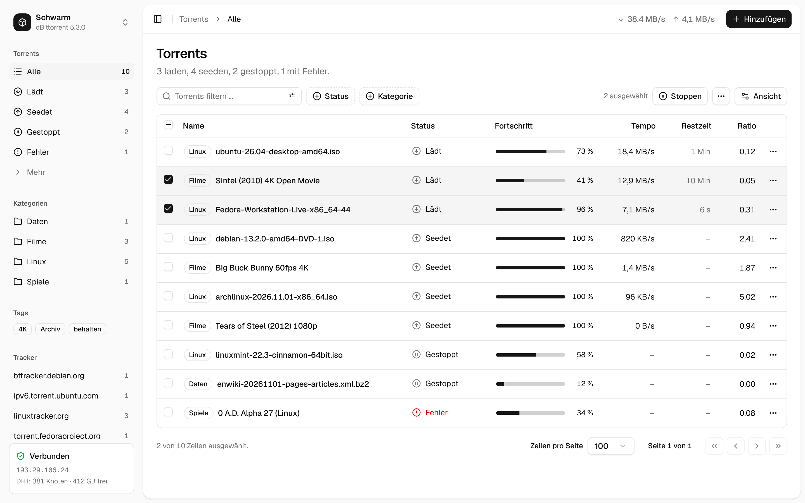
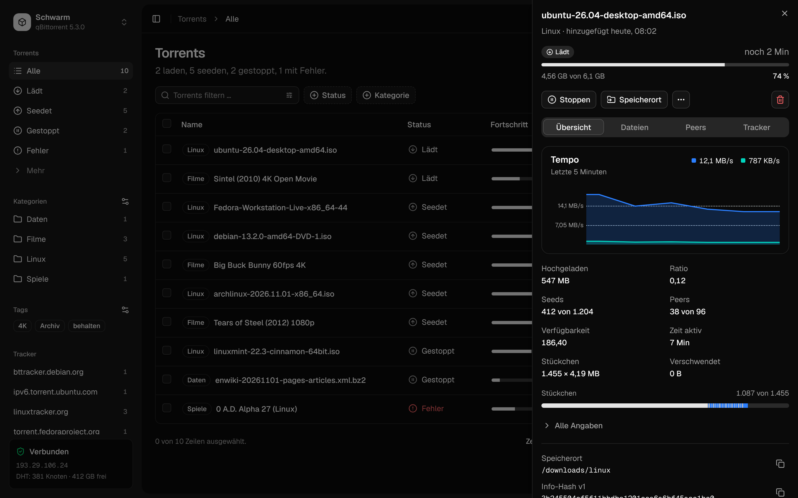
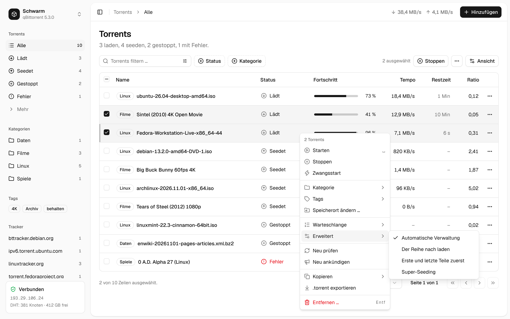
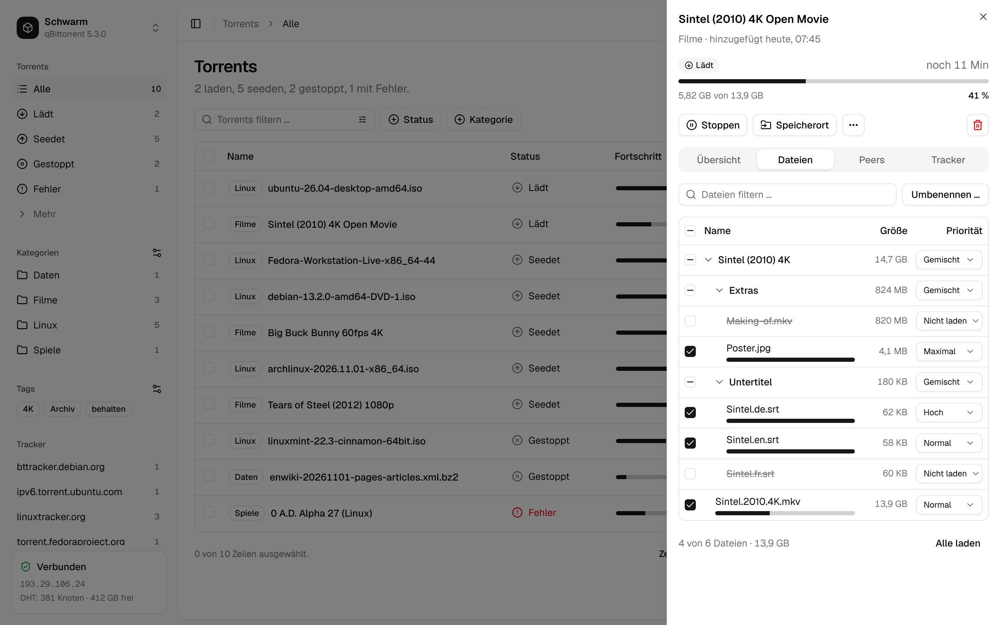
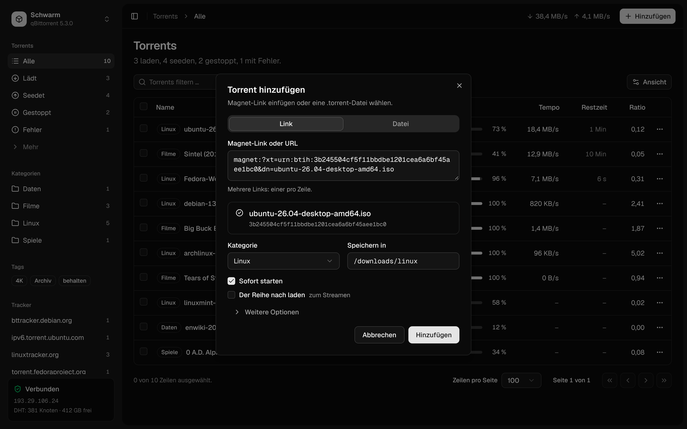
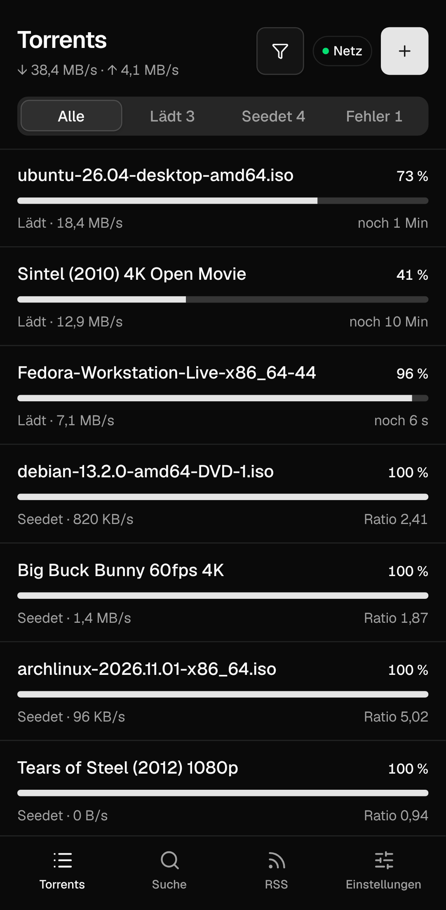
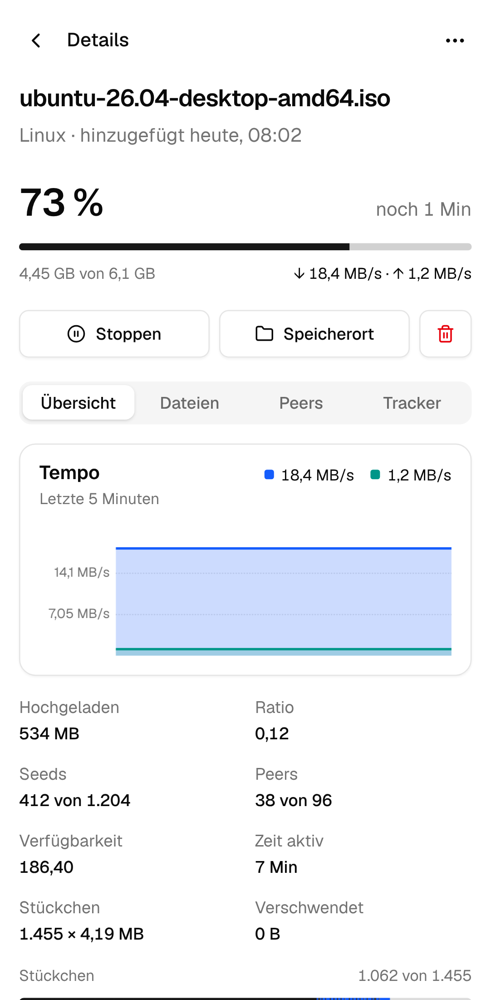

<div align="center">



<h1>Schwarm: eine moderne Weboberfläche für qBittorrent</h1>

**Eine ruhige, moderne Alternative zur Weboberfläche von qBittorrent, für Computer und Handy.**<br>
Torrents in einer klaren Liste verwalten, mit Filtern, Details, Kontextmenü und Drag & Drop.<br>
Statische Dateien, die qBittorrent selbst ausliefert: kein Server, kein Container, nichts extra.

[](https://github.com/firsttris/schwarm/actions/workflows/ci.yml)
[](https://github.com/firsttris/schwarm/releases/latest)
[](https://www.qbittorrent.org)
[](LICENSE)

[Installation](#-installation) •
[Funktionen](#-funktionen) •
[Bilder](#-bilder) •
[Alternativen](#-schwarm-und-die-alternativen) •
[Fragen](#-häufige-fragen) •
[English](README.md)

</div>

## 💡 Warum Schwarm?

Die eingebaute Weboberfläche von qBittorrent zeigt alles auf einmal, VueTorrent ist bunt und dicht.
Schwarm lässt jede Funktion erreichbar, stellt aber das Häufige nach vorn und das Seltene eine
Ebene tiefer.

- **Ruhig**: neutrale Farben, verständliche Wörter statt Fachjargon („Der Reihe nach laden“ statt
  „Sequential download“), Farbe nur, wo sie etwas bedeutet (Fehler, Verbindung).
- **Schnell auch mit Tausenden Torrents**: virtualisierte Liste, nur Änderungen von qBittorrent
  werden geladen.
- **Auch fürs Handy**: Liste, Details im Vollbild, langer Druck für Aktionen, Leiste unten.
- **Nichts zu betreiben**: ein Ordner mit statischen Dateien, den qBittorrent als alternative
  Weboberfläche ausliefert.

Läuft überall, wo qBittorrent läuft: Linux, Windows, macOS, NAS, Docker (`linuxserver/qbittorrent`),
auch hinter einem VPN-Container wie gluetun.

## 🚀 Installation

1. `schwarm-vX.Y.Z.zip` aus dem [neuesten Release](https://github.com/firsttris/schwarm/releases/latest)
   laden und dort entpacken, wo qBittorrent es lesen kann. Es entsteht ein Ordner `schwarm/` mit
   `public/` darin.
2. In qBittorrent: **Optionen → Web UI → Alternative Web UI verwenden** und den Pfad auf den Ordner
   `schwarm` setzen (den, der `public/` enthält).
3. Weboberfläche neu laden.

**Docker (`linuxserver/qbittorrent`)**: ins Config-Volume entpacken, z. B. nach `/config/schwarm`,
und `/config/schwarm` als Pfad der alternativen Weboberfläche eintragen.

```bash
cd /pfad/zur/qbittorrent/config && curl -L -o schwarm.zip \
  "$(curl -s https://api.github.com/repos/firsttris/schwarm/releases/latest | grep -o 'https://[^"]*schwarm-v[^"]*\.zip')" \
  && unzip -o schwarm.zip && rm schwarm.zip
```

Zurück geht es mit dem Haken bei „Alternative Web UI verwenden“. Schwarm nutzt die Anmeldung von
qBittorrent und merkt sich nur seine Anzeige-Einstellungen (Design, Sprache, Spalten) im Browser.

## ✨ Funktionen

### 📋 Torrent-Liste

- **Tabelle**: Auswahl, Sortierung, 25 Spalten zur Wahl unter „Ansicht“, Seiten, Zeilenzähler.
- **Filter**: Status, Kategorien (mit Unterkategorien), Tags und Tracker in der Seitenleiste; ein
  Filterfeld für Name, Speicherort oder Info-Hash, auch als regulärer Ausdruck; Filterknöpfe für
  Status und Kategorie.
- **Aktionen** im Kontextmenü, im Zeilenmenü und in der Werkzeugleiste: starten, stoppen,
  Zwangsstart, Kategorie, Tags, Speicherort ändern, umbenennen, Warteschlange, automatische
  Verwaltung, der Reihe nach laden, erste und letzte Teile zuerst, Super-Seeding, neu prüfen, neu
  ankündigen, kopieren (Name, Hashes, Magnet-Link, Pfad), .torrent exportieren, entfernen mit oder
  ohne Dateien, und Limits (Tempo, Ratio, Seed-Zeit).
- **Warteschlange**: über das Menü nach oben und unten, oder Zeilen ziehen, wenn nach
  Warteschlange sortiert ist.
- **Tastatur**: Pfeile, Umschalt und Strg zum Auswählen, Leertaste startet oder stoppt, Entf
  entfernt, F2 benennt um, Enter öffnet die Details.

### 🔎 Details

- **Übersicht**: Tempo der letzten Minuten, Kennzahlen, Stückchen, alles Weitere aufklappbar.
- **Dateien**: Dateibaum mit Prioritäten (nicht laden, normal, hoch, maximal) und Filter; eine Datei
  oder viele auf einmal umbenennen, mit Suchen und Ersetzen, regulären Ausdrücken, Nummerierung und
  Vorschau.
- **Peers**: Programm, Land, Flags, Fortschritt und Tempo; Peers hinzufügen, kopieren, sperren.
- **Tracker**: Status, Stufe, Seeds und Peers, Meldungen; hinzufügen, bearbeiten, entfernen, neu
  ankündigen; DHT, PeX und LSD; HTTP-Quellen.

### ➕ Torrents hinzufügen

- **Magnet-Links, URLs und .torrent-Dateien**, auch mehrere, oder einfach auf die Seite ziehen.
- **Sehen, was man hinzufügt**: Größe und Dateiliste, sobald qBittorrent die Infos hat, und
  auswählen, welche Dateien geladen werden.
- **Kategorie und Ordner** sofort; Tags, Name, Ordner für Unfertiges, Verwaltung, Ordnerstruktur,
  Anhalten-Bedingung, Warteschlange, Prüfung überspringen und Limits unter „Weitere Optionen“.

### ⚙️ Ordnen und Tempo

- **Kategorien und Tags** in einem Dialog: anlegen, Ordner festlegen, Unterkategorien, löschen,
  Unbenutzte entfernen.
- **Tempo-Menü** oben: langsamer Modus (alternative Limits) mit einem Klick, normale und langsame
  Limits und ein Zeitplan für den langsamen Modus.
- **Alle starten, alle stoppen, alles anhalten** im Menü hinter dem App-Namen.

### 📱 Überall

- **Handy-Ansicht** mit Liste, Details im Vollbild, langem Druck für Aktionen und Leiste unten.
- **Hell, dunkel oder wie das System**, Deutsch und Englisch (folgt dem Browser).
- **Anmeldung** nur, wenn qBittorrent danach fragt (nicht in freigegebenen Netzen).

### 🔍 Suche

- **Suchen über die Such-Plugins von qBittorrent**: ein Feld, Kategorie, Ergebnisse nach Seeds
  sortiert, Filter für Quelle, Seeds und Größe, und „Laden“ öffnet den Hinzufügen-Dialog.
- **Plugins** in den Einstellungen: einschalten, aktualisieren, per Adresse hinzufügen, entfernen.

### 📰 RSS

- **Feeds und Artikel** in drei Spalten: Ordner, ungelesene Zahl, gelesen markieren, aktualisieren,
  umbenennen, Adresse ändern; „Laden“ öffnet den Hinzufügen-Dialog.
- **Auto-Downloader** mit Live-Vorschau: Jeder aktuelle Artikel zeigt, ob die Regel ihn nimmt und
  warum nicht („fehlt: desktop“, „ausgeschlossen: arm64“). Folgenfilter, jede Folge nur einmal,
  Kategorie, Ordner, Tags, Pause danach; klonen, importieren und exportieren.
- **„Regel daraus machen“** an jedem Artikel schlägt eine Regel aus dem Titel vor.

Statistik und die Einstellungen von qBittorrent folgen in den nächsten Versionen.

## 📸 Bilder

<table>
  <tr>
    <td></td>
    <td></td>
  </tr>
  <tr>
    <td></td>
    <td></td>
  </tr>
  <tr>
    <td></td>
    <td></td>
  </tr>
</table>

## 🔀 Schwarm und die Alternativen

Schwarm ist für alle, die eine aufgeräumte, moderne Oberfläche für qBittorrent wollen, auch am Handy.

| | Was es ist | Was Schwarm anders macht |
|---|---|---|
| [qBittorrent WebUI](https://github.com/qbittorrent/qBittorrent) | die eingebaute Weboberfläche, wie das Desktop-Programm | weniger auf einmal, Handy-Ansicht, verständliche Wörter |
| [VueTorrent](https://github.com/VueTorrent/VueTorrent) | beliebte Alternative mit vielen Optionen | ruhiger, neutraler Look im Stil von shadcn/ui, Tabelle mit Tastatur |

## ❓ Häufige Fragen

### Gibt es eine moderne Weboberfläche für qBittorrent?
Ja: Schwarm ersetzt die eingebaute Oberfläche als „alternative Web UI“ von qBittorrent. Es nutzt
dieselbe WebUI-API, es muss nichts weiter installiert werden.

### Läuft Schwarm mit qBittorrent in Docker?
Ja. Den entpackten Ordner ins Config-Volume legen (bei `linuxserver/qbittorrent`:
`/config/schwarm`) und diesen Pfad als alternative Web UI eintragen.

### Welche qBittorrent-Version brauche ich?
Gebaut ist es für qBittorrent 5.3 (WebUI-API 2.16). qBittorrent ab 5.0 sollte gehen; 4.x nutzt
ältere API-Namen für Starten und Stoppen.

### Braucht es einen eigenen Server oder eine eigene Anmeldung?
Nein. qBittorrent liefert die Dateien aus und übernimmt die Anmeldung.

## 🛠️ Entwicklung

Braucht [Bun](https://bun.sh) 1.4.

```bash
git clone https://github.com/firsttris/schwarm && cd schwarm
bun install
bun run dev   # Vite auf http://localhost:5173 mit einem Schein-qBittorrent (dev/mock-server.ts)
```

React, TanStack Router (Hash-History), Query, Table und Virtual, Tailwind CSS 4 mit
shadcn/ui-Komponenten, Paraglide (Deutsch, Englisch), uPlot, Vitest und Playwright. Prüfungen:

```bash
bun run typecheck && bun run lint && bun run test && bun run build && bun run e2e
```

`bun run screenshots` erneuert die Bilder in `docs/screenshots/`. Ein Release ist die Aktion
„Bump version“, die `vX.Y.Z` taggt; der Release-Workflow hängt `schwarm-vX.Y.Z.zip` an.

## 🤝 Mitmachen

Issues und Pull Requests sind willkommen. Bei Fehlern bitte die qBittorrent-Version, den Browser und
die Schritte nennen. Vor einem Pull Request bitte die Prüfungen oben laufen lassen.

---

<div align="center">

⭐ Gefällt dir Schwarm? Ein [Stern auf GitHub](https://github.com/firsttris/schwarm) hilft anderen, es zu finden.<br>
🐛 [Fehler melden](https://github.com/firsttris/schwarm/issues/new) · 💡 [Idee vorschlagen](https://github.com/firsttris/schwarm/issues/new)

<sub>Lizenz: <a href="LICENSE">AGPL-3.0</a> · © Tristan Teufel und Mitwirkende · <a href="README.md">English version</a><br>
Wer eine veränderte Version weitergibt oder für andere betreibt, muss ihren Quellcode unter der AGPL anbieten; eine kommerzielle Lizenz ohne diese Pflichten gibt es über <a href="https://teufel-it.de">teufel-it.de</a>.<br>
Schwarm steht in keiner Verbindung zum qBittorrent-Projekt.</sub>

</div>
