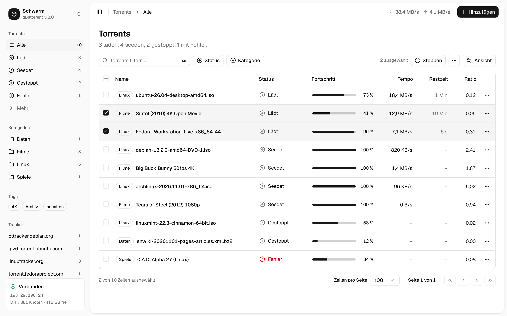
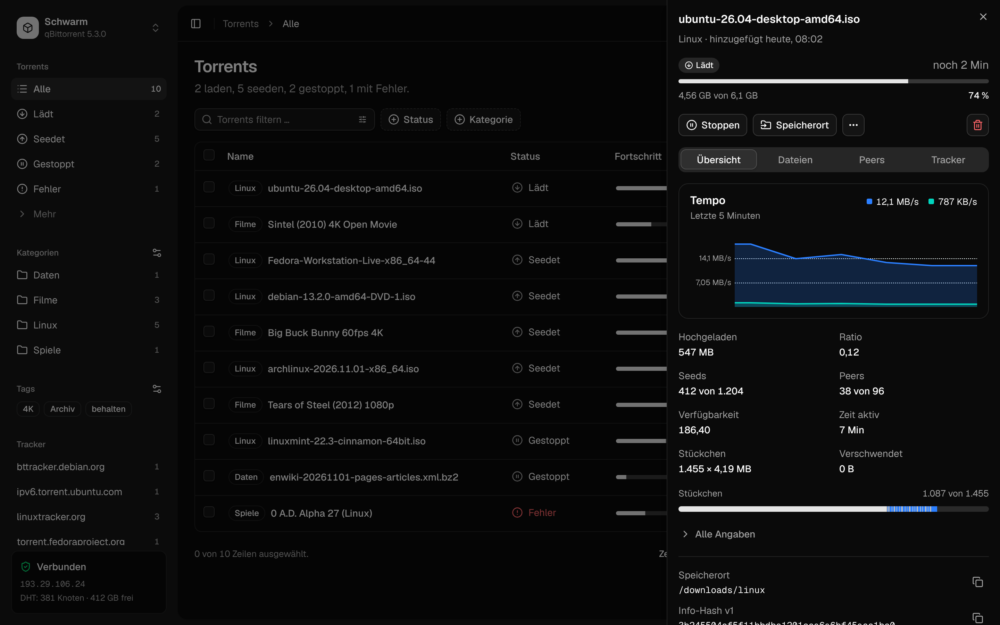
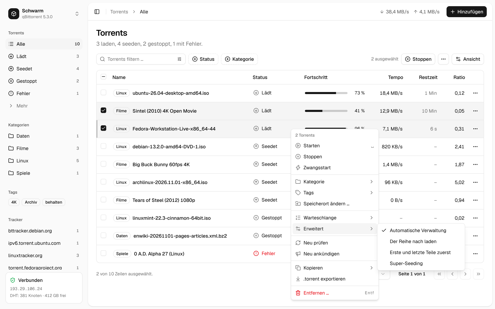
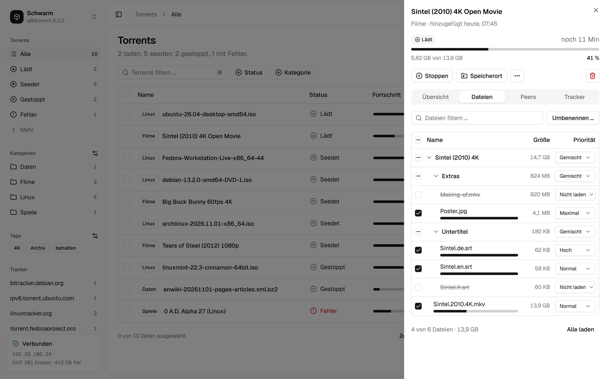
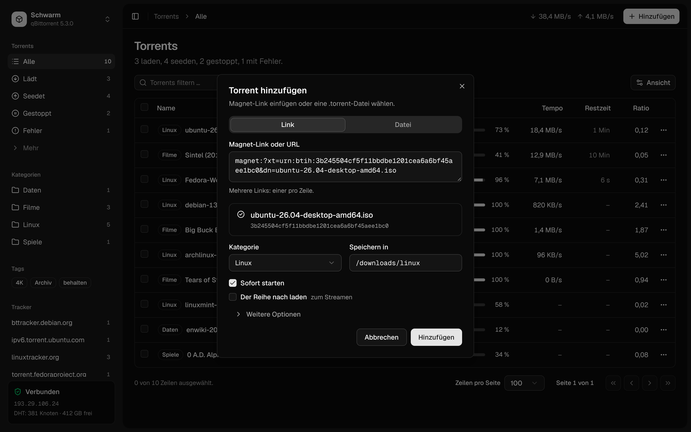
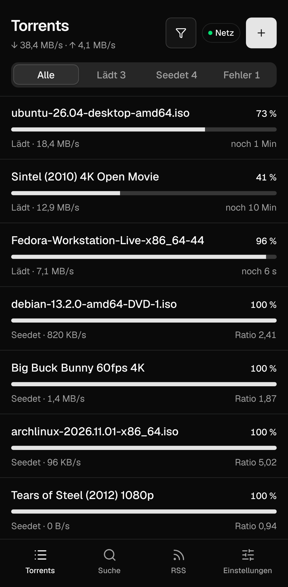
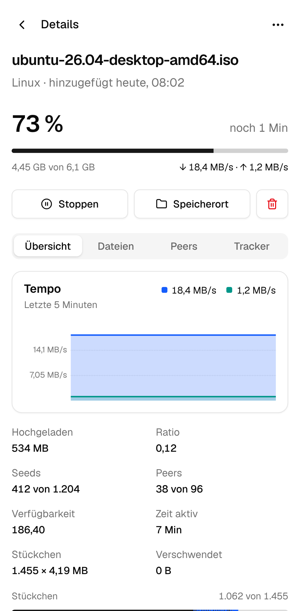

<div align="center">



<h1>Schwarm: a modern web UI for qBittorrent</h1>

**A calm, modern alternative WebUI for qBittorrent, for the desktop and the phone.**<br>
Manage your torrents in a clear list with filters, details, a context menu and drag & drop.<br>
Static files that qBittorrent serves itself: no server, no container, nothing else to run.

[](https://github.com/firsttris/schwarm/actions/workflows/ci.yml)
[](https://github.com/firsttris/schwarm/releases/latest)
[](https://www.qbittorrent.org)
[](LICENSE)

[Install](#-install) •
[Features](#-features) •
[Screenshots](#-screenshots) •
[Alternatives](#-schwarm-and-the-alternatives) •
[FAQ](#-faq) •
[Deutsch](README.de.md)

</div>

## 💡 Why Schwarm?

qBittorrent's own web UI shows everything at once, VueTorrent is colourful and dense. Schwarm keeps
every feature of the qBittorrent WebUI within reach, but puts the common ones first and the rare
ones one level deeper.

- **Calm by design**: neutral colours, plain words instead of jargon ("Download in order" instead of
  "Sequential download"), colour only where it means something (errors, connection state).
- **Fast with thousands of torrents**: virtualised list, incremental updates from qBittorrent,
  nothing reloaded that did not change.
- **Made for the phone too**: list, full-screen details, long press for actions, bottom tab bar.
- **Nothing to run**: a folder of static files that qBittorrent serves as its alternative WebUI.

Runs wherever qBittorrent runs: Linux, Windows, macOS, a NAS, Docker (`linuxserver/qbittorrent`),
behind a VPN container such as gluetun.

## 🚀 Install

1. Download `schwarm-vX.Y.Z.zip` from the [latest release](https://github.com/firsttris/schwarm/releases/latest)
   and unpack it somewhere qBittorrent can read it. You get a folder `schwarm/` with `public/` inside.
2. In qBittorrent: **Options → Web UI → Use alternative WebUI**, and set the path to the `schwarm`
   folder (the one that contains `public/`).
3. Reload the web UI.

**Docker (`linuxserver/qbittorrent`)**: unpack into the config volume, e.g. `/config/schwarm`, and
set the alternative WebUI path to `/config/schwarm`.

```bash
cd /path/to/qbittorrent/config && curl -L -o schwarm.zip \
  "$(curl -s https://api.github.com/repos/firsttris/schwarm/releases/latest | grep -o 'https://[^"]*schwarm-v[^"]*\.zip')" \
  && unzip -o schwarm.zip && rm schwarm.zip
```

To go back, untick "Use alternative WebUI". Schwarm uses qBittorrent's own login and remembers
only its display settings (theme, language, columns) in your browser.

## ✨ Features

### 📋 Torrent list

- **Data table**: selection, sorting, 25 columns to choose from in "View", pages, row count.
- **Filters**: status, categories (with subcategories), tags and trackers in the sidebar; a filter
  field that searches the name, the save path or the info hash, also with a regular expression;
  status and category filter buttons.
- **Actions** in the context menu, the row menu and the toolbar: start, stop, force start, category,
  tags, set location, rename, queue, automatic management, sequential download, first and last
  pieces first, super seeding, recheck, reannounce, copy (name, hashes, magnet link, path),
  export .torrent, remove with or without files, and limits (speed, ratio, seeding time).
- **Queue**: move up and down from the menu, or drag rows while sorted by queue position.
- **Keyboard**: arrows, Shift and Ctrl to select, Space to start or stop, Del to remove, F2 to
  rename, Enter for the details.

### 🔎 Details

- **Overview**: speed chart of the last minutes, key figures, pieces bar, all other details folded.
- **Files**: file tree with priorities (skip, normal, high, maximum) and a filter; rename one file
  or many at once with search and replace, regular expressions and numbering, with a preview.
- **Peers**: client, country, flags, progress and speed; add, copy and ban peers.
- **Trackers**: status, tier, seeds and peers, messages; add, edit, remove, reannounce; DHT, PeX and
  LSD; HTTP sources (web seeds).

### ➕ Adding torrents

- **Magnet links, URLs and .torrent files**, several at once, or drop them anywhere on the page.
- **See what you add**: size and file list once qBittorrent has the metadata, and choose which
  files to load before the download starts.
- **Category and folder** right away; tags, name, incomplete folder, management, content layout,
  stop condition, queue position, hash check skip and limits under "More options".

### ⚙️ Organising and speed

- **Categories and tags** in one dialog: create, set the folder, subcategories, delete, remove the
  unused ones.
- **Speed menu** in the header: slow mode (alternative limits) with one click, normal and slow
  limits, and a schedule for the slow mode.
- **Start all, stop all, pause everything** from the menu behind the app name.

### 📱 Everywhere

- **Phone layout** with list, full-screen details, long press for the actions and a bottom tab bar.
- **Light, dark or system**, German and English (follows the browser).
- **Login** only when qBittorrent asks for it (not on whitelisted networks).

### 🔍 Search

- **Search through qBittorrent's search plugins**: one field, category, results sorted by seeds,
  filters for source, seeds and size, and "Download" opens the add dialog.
- **Plugins** in the settings: enable, update, add by URL, remove.

### 📰 RSS

- **Feeds and articles** in three columns: folders, unread counts, mark as read, refresh, rename,
  change the URL; "Download" opens the add dialog.
- **Auto-downloader** with a live preview: every recent article shows whether the rule takes it,
  and why not ("missing: desktop", "excluded: arm64"). Episode filter, each episode only once,
  category, folder, tags, pause afterwards; clone, import and export.
- **"Make a rule from it"** on any article suggests a rule from its title.

Statistics and qBittorrent's settings follow in the next versions.

## 📸 Screenshots

<table>
  <tr>
    <td></td>
    <td></td>
  </tr>
  <tr>
    <td></td>
    <td></td>
  </tr>
  <tr>
    <td></td>
    <td></td>
  </tr>
</table>

## 🔀 Schwarm and the alternatives

Schwarm is made for people who want a tidy, modern qBittorrent UI that works on the phone too.

| | What it is | Where Schwarm differs |
|---|---|---|
| [qBittorrent WebUI](https://github.com/qbittorrent/qBittorrent) | the built-in web UI, mirrors the desktop app | fewer things on screen at once, phone layout, plain words |
| [VueTorrent](https://github.com/VueTorrent/VueTorrent) | popular alternative WebUI with many options | calmer, neutral look in the shadcn/ui style, desktop table with keyboard |

## ❓ FAQ

### Is there a modern web UI for qBittorrent?
Yes: Schwarm replaces the stock web UI as qBittorrent's "alternative WebUI". It talks to the same
WebUI API, so nothing else needs to be installed.

### Does Schwarm work with qBittorrent in Docker?
Yes. Put the unpacked folder into the config volume (for `linuxserver/qbittorrent`:
`/config/schwarm`) and set that path as the alternative WebUI.

### Which qBittorrent version do I need?
It is built against qBittorrent 5.3 (WebUI API 2.16). qBittorrent 5.0 and newer should work; 4.x
uses older API names for start and stop.

### Does it need its own server or login?
No. qBittorrent serves the files and does the login.

## 🛠️ Development

Requires [Bun](https://bun.sh) 1.4.

```bash
git clone https://github.com/firsttris/schwarm && cd schwarm
bun install
bun run dev   # Vite on http://localhost:5173 with a mock qBittorrent (dev/mock-server.ts)
```

React, TanStack Router (hash history), Query, Table and Virtual, Tailwind CSS 4 with shadcn/ui
components, Paraglide (German, English), uPlot, Vitest and Playwright. Checks:

```bash
bun run typecheck && bun run lint && bun run test && bun run build && bun run e2e
```

`bun run screenshots` updates the pictures in `docs/screenshots/`. A release is the "Bump version"
action, which tags `vX.Y.Z`; the release workflow attaches `schwarm-vX.Y.Z.zip`.

## 🤝 Contributing

Issues and pull requests are welcome. For a bug, please name your qBittorrent version, the browser
and what you did. Please run the checks above before opening a pull request.

---

<div align="center">

⭐ Like Schwarm? A [star on GitHub](https://github.com/firsttris/schwarm) helps others find it.<br>
🐛 [Report a bug](https://github.com/firsttris/schwarm/issues/new) · 💡 [Request a feature](https://github.com/firsttris/schwarm/issues/new)

<sub>License: <a href="LICENSE">AGPL-3.0</a> · © Tristan Teufel and contributors · <a href="README.de.md">Deutsche Version</a><br>
Changed versions you pass on or run for others must offer their source code under the AGPL; a commercial license without these obligations is available via <a href="https://teufel-it.de">teufel-it.de</a>.<br>
Schwarm is not affiliated with the qBittorrent project.</sub>

</div>
