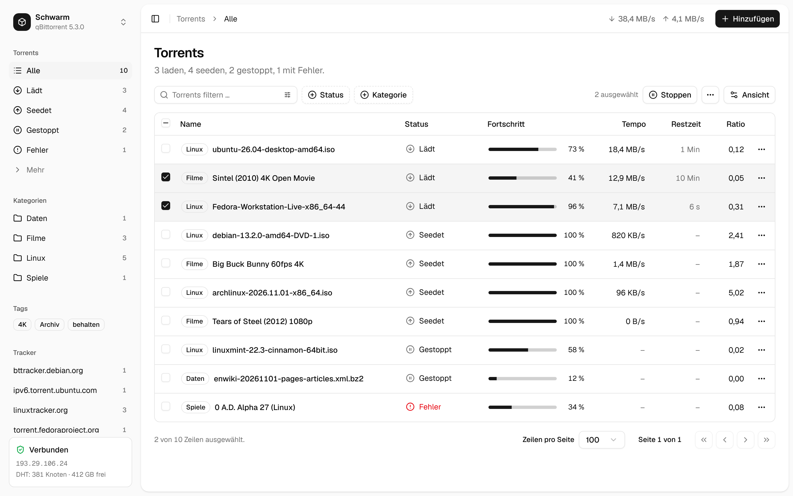
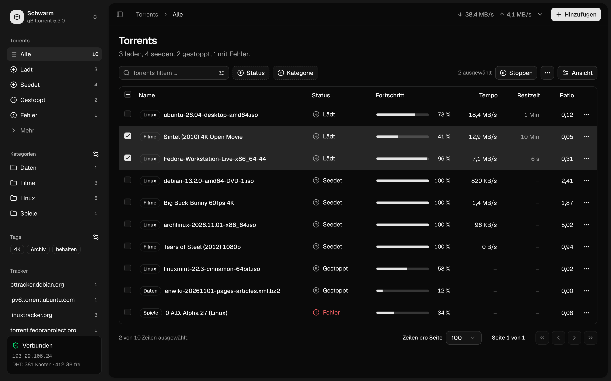
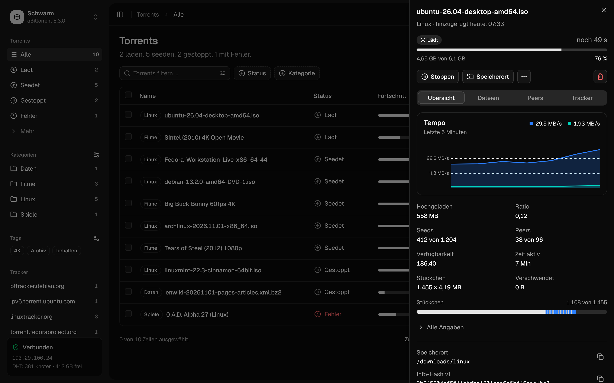
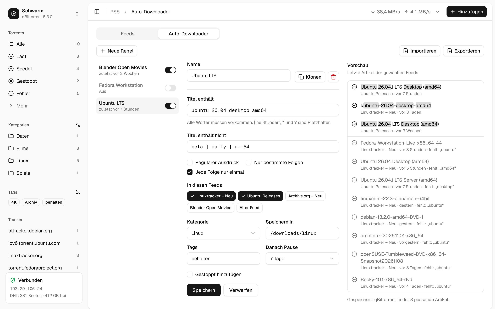
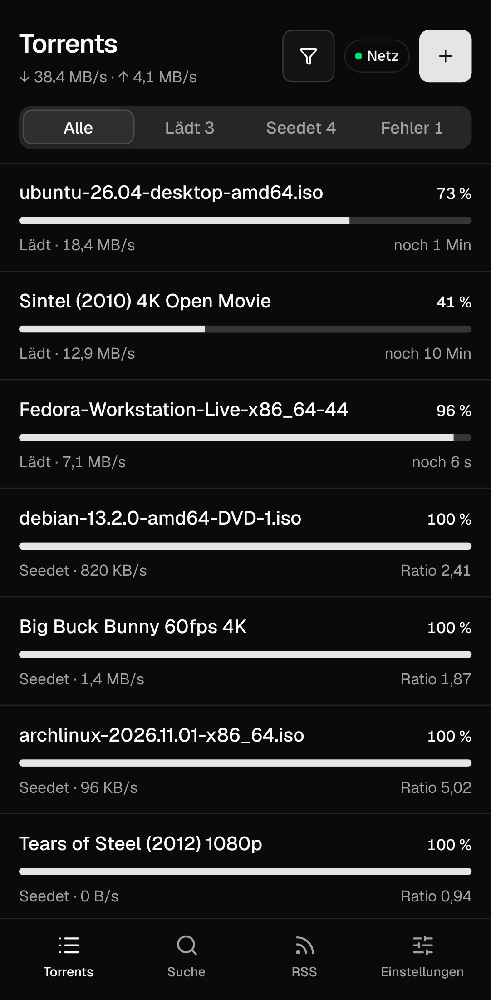
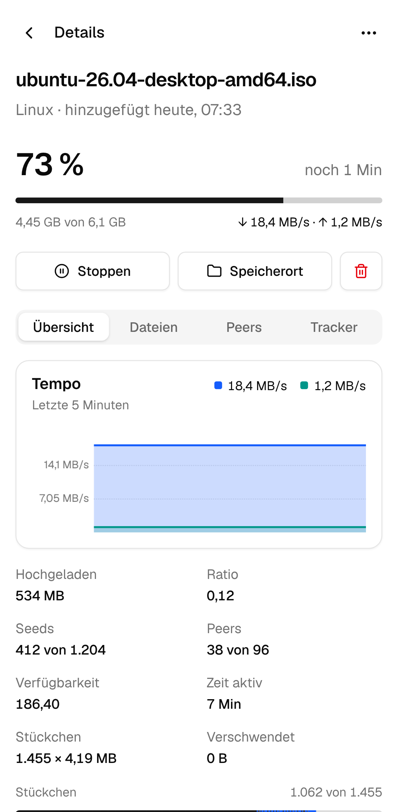
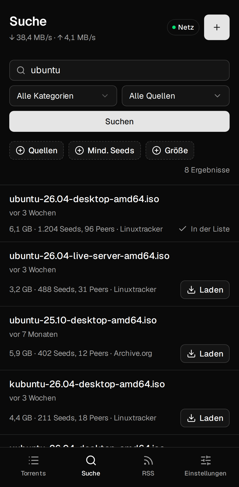

<div class="hero" markdown>

# Schwarm

<p class="tagline">A calm, modern web UI for qBittorrent, for the desktop and the phone.
Static files that qBittorrent serves itself: no server, no container, nothing else to run.</p>

[Install :material-download:](install.md){ .md-button .md-button--primary }
[See the features](guide.md){ .md-button }
[GitHub :fontawesome-brands-github:](https://github.com/firsttris/schwarm){ .md-button }

{ .only-light }
{ .only-dark }

</div>

## Why Schwarm?

qBittorrent's own web UI shows everything at once, VueTorrent is colourful and dense. Schwarm keeps
every feature of the qBittorrent WebUI within reach, but puts the common ones first and the rare
ones one level deeper.

<div class="grid cards" markdown>

-   :material-leaf: **Calm by design**

    ---

    Neutral colours, plain words instead of jargon ("Download in order" instead of "Sequential
    download"), colour only where it means something.

-   :material-lightning-bolt: **Fast with thousands of torrents**

    ---

    A virtualised list and incremental updates from qBittorrent: nothing is reloaded that did not
    change.

-   :material-cellphone: **Made for the phone too**

    ---

    List, full-screen details, long press for the actions, a bottom tab bar. Installable as an app.

-   :material-package-variant-closed: **Nothing to run**

    ---

    A folder of static files that qBittorrent serves as its alternative WebUI, or one line as a
    Docker mod for `linuxserver/qbittorrent`.

</div>

## Everything qBittorrent can do

<div class="grid cards" markdown>

-   :material-format-list-bulleted: **Torrent list**

    ---

    Filters by status, category, tag and tracker, 25 columns, context menu, drag & drop for the
    queue, keyboard shortcuts.

-   :material-file-tree: **Details**

    ---

    Speed chart, pieces bar, file tree with priorities and bulk rename, peers, trackers and web
    seeds.

-   :material-plus-box: **Adding torrents**

    ---

    Magnet links, URLs and files, dropped anywhere. See the files and pick them before the
    download starts.

-   :material-magnify: **Search**

    ---

    qBittorrent's search plugins in one field, with filters for source, seeds and size.

-   :material-rss: **RSS**

    ---

    Feeds and articles, and an auto-downloader with a live preview of what each rule takes, and
    why not.

-   :material-cog: **Settings**

    ---

    The common options in plain words, all 240 options in one searchable list, VPN aware.

</div>

[All features :material-arrow-right:](guide.md)

## Install in one line

With `linuxserver/qbittorrent`, add the Docker mod to the container's environment and recreate it:

```yaml
environment:
  - DOCKER_MODS=tristanteu/schwarm:latest
```

Any other setup: unpack the release ZIP and point qBittorrent's *alternative WebUI* at it.
[Install :material-arrow-right:](install.md)

## Light, dark, German, English

<div class="shots" markdown>




</div>

<div class="shots phone" markdown>





</div>

[More screenshots :material-arrow-right:](screenshots.md)
